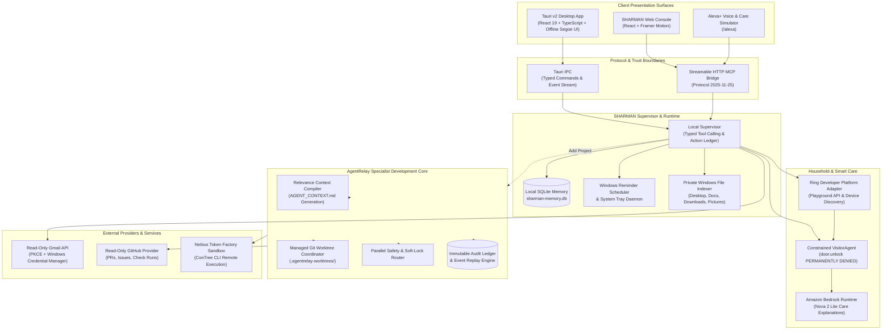

# SHARMAN 🛡️🤖

> **A Permission-Aware, Local-First Windows AI Assistant, Autonomous Multi-Agent Coordinator & Model Context Protocol (MCP) Runtime**

[](LICENSE)
[-orange.svg)](https://www.rust-lang.org/)
[](https://tauri.app/)
[](https://www.typescriptlang.org/)
[](https://modelcontextprotocol.io/)
[](https://aws.amazon.com/ecs/)
[](https://aws.amazon.com/bedrock/)
[](https://ring.com/)

---

## 🌐 Live Demonstrations & Judging Links

The SHARMAN web console and Streamable HTTP MCP bridge are deployed on **AWS ECS Express Mode (Sydney - `ap-southeast-2`)**:

| Surface | Description | Live Endpoint |
| :--- | :--- | :--- |
| 🖥️ **Web Console** | Interactive 7-view web application | [Open SHARMAN](https://sh-62bba116286d48cfb495d1a3677193ba.ecs.ap-southeast-2.on.aws/) |
| 🏡 **SHARMAN Home** | Ring developer device discovery & care simulator | [Open /home](https://sh-62bba116286d48cfb495d1a3677193ba.ecs.ap-southeast-2.on.aws/home) |
| 🎙️ **Alexa+ Simulation** | Care workflows & Streamable MCP tool execution | [Open /alexa](https://sh-62bba116286d48cfb495d1a3677193ba.ecs.ap-southeast-2.on.aws/alexa) |
| ⚡ **MCP Bridge** | Real Streamable HTTP MCP endpoint (Protocol `2025-11-25`) | [Open /mcp](https://sh-62bba116286d48cfb495d1a3677193ba.ecs.ap-southeast-2.on.aws/mcp) |
| 🩺 **System Health** | Service & container status endpoint | [Open /health](https://sh-62bba116286d48cfb495d1a3677193ba.ecs.ap-southeast-2.on.aws/health) |

> 🔒 **Security Notice:** The public deployment uses **shared disposable sample data**. It does not access personal Gmail, local Windows databases, or desktop notifications. Bedrock inference is disabled in public containers and available as an opt-in local capability.

---

## 📖 Table of Contents

- [Overview](#-overview)
- [System Architecture](#-system-architecture)
- [Key Modules & Capabilities](#-key-modules--capabilities)
  - [1. Native Windows Assistant](#1-native-windows-assistant)
  - [2. Privacy-First Gmail Inbox Intelligence](#2-privacy-first-gmail-inbox-intelligence)
  - [3. SHARMAN Home (Ring & Smart Care)](#3-sharman-home-ring--smart-care)
  - [4. AgentRelay Multi-Agent Coordinator](#4-agentrelay-multi-agent-coordinator)
  - [5. Model Context Protocol (MCP) Bridge](#5-model-context-protocol-mcp-bridge)
- [Directory Layout](#-directory-layout)
- [Prerequisites](#-prerequisites)
- [Getting Started](#-getting-started)
  - [Running the Native Desktop App](#running-the-native-desktop-app)
  - [Running the MCP Bridge & Local Web API](#running-the-mcp-bridge--local-web-api)
  - [Running the Web Console](#running-the-web-console)
  - [Building the NSIS Windows Installer](#building-the-nsis-windows-installer)
- [Verification & Quality Gates](#-verification--quality-gates)
- [Security & Trust Boundaries](#-security--trust-boundaries)
- [Key Documentation](#-key-documentation)

---

## 💡 Overview

**SHARMAN** is a local-first Windows assistant designed around user safety, explicit permission boundaries, and zero unconstrained model execution. It opens with one question:

> **"What do you want to do?"**

Unlike developer tools that force complex workspace onboarding, SHARMAN instantly serves daily personal and desktop tasks—local file search, media playback, background reminders, daily coding challenges, and email intelligence—with **no Git repository required**.

When software engineering workflows are requested, SHARMAN activates **AgentRelay**: an embedded specialist multi-agent coordination layer that orchestrates external coding agents (Claude, Codex, Gemini, Cursor, Copilot) with deterministic SQLite memory, versioned task DAGs, workspace soft locks, parallel safety analysis, and isolated Git worktrees.

---

## 🏗️ System Architecture



---

## ⚡ Key Modules & Capabilities

### 1. Native Windows Assistant
- **Zero Raw Shell Access:** The assistant never feeds raw LLM output into `cmd.exe` or PowerShell. Every request routes through a typed, auditable tool registry.
- **Fast Private File Search:** Recursively discovers files and recency across `Downloads`, `Desktop`, `Documents`, and `Pictures` with date filtering.
- **Media & Web Control:** Plays local audio via default Windows associations; resolves and plays exact matches on YouTube; handles validated `http`/`https` links with user confirmation.
- **Task & Reminder Scheduler:** Creates durable personal tasks and background Windows notifications powered by Windows Task Scheduler / WinRT notifications.
- **LeetCode Practice:** Structured Daily Challenge resolution and problem retrieval with safe local fallbacks.
- **Adaptive Model Profile:** Recommends 1–3B through 20–32B quantized local model tiers based on host RAM/CPU (supports optional Ollama integration).

### 2. Privacy-First Gmail Inbox Intelligence
- **PKCE OAuth 2.0:** Secure read-only access with Google Identity services.
- **Zero Secrets in SQLite/Git:** OAuth refresh tokens and secrets reside exclusively in the **Windows Credential Manager** or ephemeral environment memory.
- **Deterministic Action Extraction:** Parses deadlines, actionable tasks, and follow-ups from incoming threads without sending email contents to third-party LLMs.
- **One-Click Actions:** Convert extracted deadlines into native Windows reminders in a single click.

### 3. SHARMAN Home (Ring & Smart Care)
- **Ring Developer Platform Integration:** Verified integration with the official Ring Developer Playground API and Streamable MCP knowledge gateway for device discovery, health telemetry, and event history.
- **Constrained `VisitorAgent`:** Handles simulated front-door events (`expected_delivery`, `repeated_unexpected`, `blocked_unlock`) under a fail-closed sandbox.
- **Immutable Safety Invariant:** **`door.unlock` is permanently forbidden.** Unauthorized physical access, automated purchases, and arbitrary system calls fail closed with denial receipts.
- **Amazon Bedrock Accessibility Explanations:** Opt-in accessibility care summaries powered by **Amazon Nova 2 Lite** (`global.amazon.nova-2-lite-v1:0` via `ConverseCommand`) with an automatic deterministic local fallback.
- **Household State Replay:** Reconstructs past household states at any exact microsecond (`reconstruct_state_at`) with zero side-effects.

### 4. AgentRelay Multi-Agent Coordinator
- **Multi-Agent Coordination:** Detects and coordinates external coding assistants (Claude, Codex, Gemini, Cursor, Copilot) via manifest-driven process inspection.
- **Deterministic Context Compilation:** Compiles `AGENT_CONTEXT.md` from SQLite event ledgers using relevance scoring, recency, dependency DAGs, and token budgets (2k, 6k, 12k).
- **Parallel Safety & Soft Locks:** Evaluates workspace path conflicts and artifact dependencies (`produces` / `consumes`) before allowing concurrent agent execution.
- **Isolated Git Worktrees:** Automatically sets up isolated Git branches and sibling worktrees under `.agentrelay-worktrees/`. Prepares merges via `git merge-tree` without dirtying the working directory.
- **Immutable Audit Ledger:** SQL trigger-protected append-only event ledger tracking decisions, rationale, commits, and verification gates.

### 5. Model Context Protocol (MCP) Bridge
- **Streamable HTTP MCP Server:** Fully compliant with MCP Protocol specification `2025-11-25`.
- **11 Permission-Annotated Tools:**
  1. `sharman_assistant_request` — Send natural language requests to the supervisor.
  2. `sharman_get_tasks` — Query active or completed tasks.
  3. `sharman_create_task` — Create a structured personal task.
  4. `sharman_get_reminders` — Inspect pending and scheduled reminders.
  5. `sharman_create_reminder` — Schedule a time-based reminder.
  6. `sharman_get_action_items` — Retrieve action items extracted from inbox.
  7. `sharman_search_inbox` — Query indexed message subjects and senders.
  8. `sharman_open_allowed_url` — Safely open validated web destinations.
  9. `sharman_home_get_status` — Inspect household zones, members, and access points.
  10. `sharman_home_handle_ring_event` — Route front-door events through `VisitorAgent`.
  11. `sharman_home_explain_with_bedrock` — Request Bedrock Nova 2 Lite care accessibility summaries.

---

## 📁 Directory Layout

```text
Sharman's/
├── agentrelay/                    # Core active workspace & release candidate
│   ├── Cargo.toml                 # Rust workspace definition (Rust 2021)
│   ├── crates/
│   │   └── agentrelay-core/       # Domain logic, SQLite memory, context compiler, replay engine
│   ├── frontend/                  # Windows desktop application (React 19 + Tauri v2)
│   │   ├── src/                   # React UI, typed IPC client, offline Segoe UI design
│   │   └── src-tauri/             # Rust native shell, tray manager, watcher, installer
│   ├── sharman-mcp/               # Streamable HTTP MCP server (Protocol 2025-11-25)
│   ├── sharman-web/               # Active web console (Assistant, Home, Alexa+, Tasks)
│   ├── docs/                      # Architectural specs, security matrices & validation reports
│   ├── fixtures/                  # Grounded synthetic Ring, Gmail, and home event fixtures
│   └── scripts/                   # Validation, judge rehearsal, and preflight automation
├── sharman-web/                   # Earlier standalone React dashboard
├── AGENT_CONTEXT.md               # Deterministically generated workspace context
├── notes.txt                      # Multi-agent handoffs and qualification logs
└── README.md                      # Primary project overview
```

---

## 🛠️ Prerequisites

To build and run SHARMAN locally on Windows:

- **OS:** Windows 10 (1809+) or Windows 11 (64-bit)
- **Node.js:** `v20.19+` or `v22.12+` (with npm)
- **Rust Toolchain:** Stable MSVC (`x86_64-pc-windows-msvc`)
- **C++ Build Tools:** Microsoft C++ Build Tools with *Desktop development with C++*
- **WebView2:** Microsoft Edge WebView2 runtime (pre-installed on modern Windows)
- **Git:** Git for Windows on system `PATH`

Install Rust and the MSVC toolchain via PowerShell:
```powershell
winget install --id Rustlang.Rustup --source winget
rustup default stable-msvc
```

---

## 🚀 Getting Started

### Running the Native Desktop App

The native desktop app runs the complete assistant with local supervisor, Windows reminders, file search, and AgentRelay integration:

```powershell
# Navigate to the desktop frontend
cd agentrelay/frontend

# Install dependencies
npm install

# Start the Tauri development desktop shell
npm run tauri dev
```

> **Tip:** Closing the desktop window minimizes SHARMAN to the Windows system tray. To exit completely, right-click the tray icon and select **Exit**.

---

### Running the MCP Bridge & Local Web API

The Streamable HTTP MCP server enables external agents, the web console, and Alexa+ workflows to communicate with SHARMAN:

```powershell
cd agentrelay/sharman-mcp
npm install
npm run build
npm run dev
```

The MCP server initializes on `http://127.0.0.1:63842`:
- MCP Endpoint: `http://127.0.0.1:63842/mcp`
- Health Check: `http://127.0.0.1:63842/health`

---

### Running the Web Console

Run the presentation web console locally with hot-reloading:

```powershell
cd agentrelay/sharman-web
npm install
npm run dev
```

Open `http://127.0.0.1:4180` in your browser to explore all 7 views: **Assistant**, **SHARMAN Home**, **Action Inbox**, **Tasks**, **Activity**, **Connections**, and **Alexa+ Simulation**.

---

### Building the NSIS Windows Installer

To generate a standalone per-user Windows installer:

```powershell
cd agentrelay/frontend
npm run tauri build -- --bundles nsis
```

The output installer (`agentrelay-desktop_<version>_x64-setup.exe`) is generated in:
`agentrelay/target/release/bundle/nsis/`

---

## 🔒 Environment Configuration

Optional environment variables for advanced capabilities:

| Variable | Scope | Purpose |
| :--- | :--- | :--- |
| `AWS_REGION` | MCP / Bedrock | Target AWS region (e.g. `ap-southeast-2` for Sydney) |
| `AWS_PROFILE` | MCP / Bedrock | Named AWS profile for Amazon Bedrock Nova 2 Lite validation |
| `RING_ACCESS_TOKEN` | MCP / Ring | Live Ring Developer Playground token for device discovery |
| `GITHUB_TOKEN` | AgentRelay | Fine-grained GitHub read token for private repos & extended rate limits |
| `NEBIUS_API_KEY` | AgentRelay | Token Factory API key for optional Nemotron context compression |
| `CONTREE_TOKEN` | AgentRelay | Authentication token for isolated ConTree remote execution sandbox |

---

## 🧪 Verification & Quality Gates

SHARMAN adheres to strict preflight qualification requirements before any release candidate is cut:

```powershell
# 1. Run Rust formatting, tests, and Clippy
cd agentrelay
cargo fmt --all --check
cargo test -p agentrelay-core
cargo clippy --workspace --all-targets -- -D warnings

# 2. Run MCP Unit & Integration Tests
cd sharman-mcp
npm test

# 3. Run E2E Integration Checks
npm run test:e2e

# 4. Execute Full Amazon Preflight Qualification
cd ..
npm run validate:amazon

# 5. Execute 3-Run Isolated Judge Rehearsal
npm run rehearse:amazon -- --runs 3
```

---

## 🛡️ Security & Trust Boundaries

1. **Deny-by-Default Execution:** Dangerous actions (`door.unlock`, file deletion, arbitrary shell commands, repository commits/pushes) are hard-locked in the core permission policy.
2. **Deterministic Fallbacks:** AI outputs are never authoritative for critical operations. If an AI call fails, times out, or hallucinates schema violations, SHARMAN falls back to deterministic local rules.
3. **No Secret Ingestion:** Secrets and tokens are never written to SQLite, event logs, generated `AGENT_CONTEXT.md`, or diagnostic archives.
4. **Isolated Worktree Boundaries:** Agents coordinate in dedicated worktrees under `.agentrelay-worktrees/`. Merges are verified via `git merge-tree` and require explicit user approval.

---

## 📚 Key Documentation

Explore the public guides and implementation files included in this repository:

- 📋 [**Application Overview & Capabilities**](agentrelay/README.md)
- 🎙️ [**MCP Bridge Setup & Tools**](agentrelay/sharman-mcp/README.md)
- 🏡 [**Web Console Setup**](agentrelay/sharman-web/README.md)
- 🔔 [**Ring Fixtures & Source Provenance**](agentrelay/sharman-mcp/test-fixtures/ring/README.md)
- ☁️ [**Bedrock Adapter & Deterministic Fallback**](agentrelay/sharman-mcp/src/bedrock.ts)
- 🚀 [**Web/MCP Container Build**](agentrelay/Dockerfile.amazon)
- 🛡️ [**Native Supervisor & Permission Enforcement**](agentrelay/frontend/src-tauri/src/supervisor.rs)
- 📧 [**Gmail OAuth & Inbox Implementation**](agentrelay/frontend/src-tauri/src/gmail.rs)
- 🔌 [**Plugin Contracts & Registry**](agentrelay/crates/agentrelay-core/src/sdk.rs)
- 📝 [**Amazon Developer Hackathon Friction Log**](agentrelay/docs/FRICTION_LOG.md)

---

## 📄 License

This project is licensed under the [MIT License](LICENSE).
